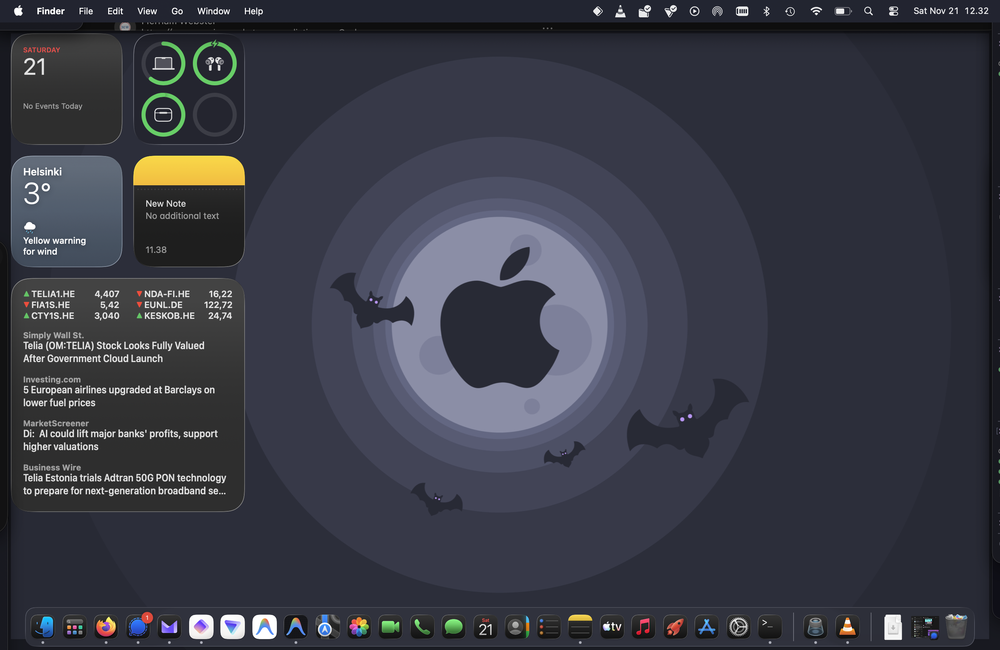
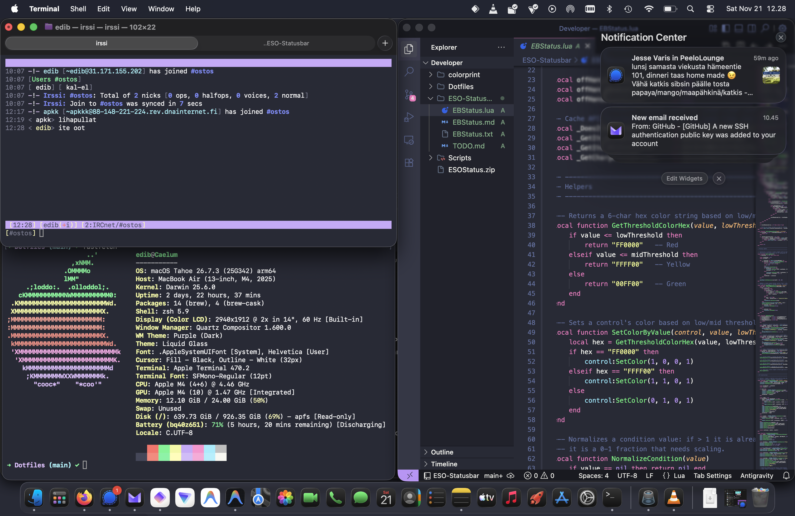

# 🧛 Dracula macOS Dotfiles

A cohesive, automated [Dracula Theme](https://draculatheme.com) environment for macOS, shell, editors, and CLI tools.

<p align="center">
  
  
</p>

---

## ✨ Features

- **macOS System**: Enables Dark Mode, sets native Purple accent color, and applies Dracula desktop wallpapers.
- **Terminal.app**: Pre-configured `Dracula.terminal` profile imported as default.
- **Zsh & Oh My Zsh**: Dracula prompt theme (`dracula.zsh-theme`), Dracula-styled `LSCOLORS` / `LS_COLORS`, and colored tab completions.
- **Vim**: Dracula color scheme with automated `vim-plug` setup.
- **GNU Nano**: Full Dracula syntax highlighting rules and interface palette.
- **Irssi**: Matching Dracula IRC client theme and configuration.
- **Firefox**: Bundled Dracula Dark Theme add-on (`.xpi`).
- **Antigravity / Gemini**: Dracula palette rules for charts, Mermaid diagrams, and UI artifacts (`GEMINI.md`).

---

## 📋 Prerequisites

Before installing, ensure you have:
- **macOS** (macOS 10.15 Catalina or newer recommended)
- **Xcode Command Line Tools** (for Git and developer tools):
  ```bash
  xcode-select --install
  ```
- **Zsh** (macOS default shell)

---

## 🚀 Quick Start

### 1. Clone the repository

```bash
# Via HTTPS
git clone https://github.com/ed1b/Dotfiles.git ~/Developer/Dotfiles

# Or via SSH
git clone git@github.com:ed1b/Dotfiles.git ~/Developer/Dotfiles

cd ~/Developer/Dotfiles
```

### 2. Run the automated installer

```bash
chmod +x setup.sh
./setup.sh
```

> [!NOTE]
> The script automatically creates timestamped backups (e.g., `~/.zshrc.backup_<timestamp>`) before modifying any existing configuration files.

### 3. Reload your environment

```bash
source ~/.zshrc
```

> [!TIP]
> Open a new terminal window or restart **Terminal.app** to see the new Dracula window settings and colors in action.

---

## 🖥️ Standalone macOS Appearance (Optional)

If you only want to apply the macOS system appearance (Dark Mode, Purple accent color, and desktop wallpaper) without modifying your shell or editor dotfiles, run:

```bash
chmod +x macos-dracula-settings.sh
./macos-dracula-settings.sh
```

---

## 🔍 Verification

Run the built-in health-check script to verify your Zsh and Oh My Zsh Dracula configuration:

```bash
./check_zshrc_dracula.sh
```

The script verifies:
1. `~/.zshrc` exists and is configured.
2. `ZSH_THEME="dracula"` is set.
3. The Dracula Oh My Zsh theme file is reachable.
4. Sourcing `~/.zshrc` produces no syntax or loading errors.
5. Loaded theme matches `dracula`.
6. Theme prompt color definitions (magenta / `#bd93f9`).
7. Git plugin is loaded in `.zshrc`.
8. Git plugin script file is present in Oh My Zsh plugins.

---

## 📁 Repository Structure

```text
├── .nanorc                    # GNU Nano Dracula palette & syntax rules
├── .vimrc                     # Vim configuration with Dracula plugin
├── .zshrc                     # Zsh configuration (Dracula theme, LSCOLORS)
├── Dracula.terminal           # Apple Terminal Dracula color scheme
├── GEMINI.md                  # Antigravity & Gemini Dracula theme rules
├── dracula.zsh-theme          # Oh My Zsh Dracula theme file
├── dracula.theme              # Irssi Dracula theme
├── check_zshrc_dracula.sh     # Health-check script for shell configuration
├── setup.sh                   # Main automated installation & backup script
├── macos-dracula-settings.sh  # Standalone macOS UI appearance script
├── screenshot-desktop.png     # macOS Desktop preview screenshot
├── screenshot-terminal.png    # Terminal & apps preview screenshot
├── firefox/                   # Firefox Dracula extension (.xpi)
│   └── dracula-dark-theme.xpi
├── irssi/                     # Irssi configuration & theme
│   ├── config
│   └── dracula.theme
└── wallpapers/                # Dracula macOS desktop wallpapers
    ├── Dracula-base.png
    └── Dracula-macos.png
```

---

## 🌐 Firefox Theme (Optional)

To apply the Dracula theme to Firefox:

```bash
open -a Firefox "firefox/dracula-dark-theme.xpi"
```

You can also drag and drop `firefox/dracula-dark-theme.xpi` into an open Firefox browser window.

---

## 📜 Credits

- Built using the [Dracula Theme](https://draculatheme.com/) color palette.
